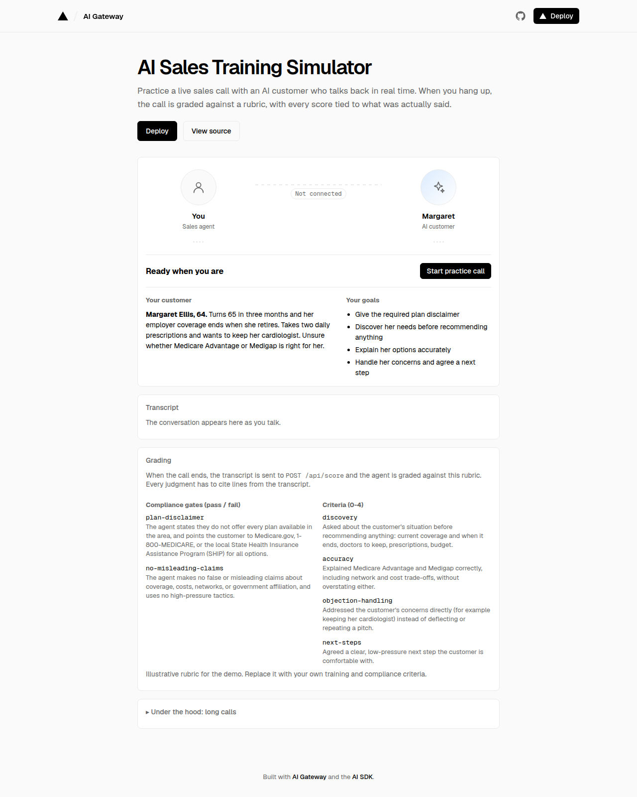

# AI Sales Training Simulator

Practice live sales calls with an AI customer who talks back in real time, then get a scorecard when you hang up. Every score cites what was actually said on the call. Built with [AI Gateway](https://vercel.com/ai-gateway) realtime voice and the [AI SDK](https://ai-sdk.dev).

The included scenario is a Medicare insurance call: a new agent talks to Margaret, a cautious prospect about to turn 65. To train for a different product, swap the persona and the rubric.



[](https://vercel.com/new/clone?repository-url=https%3A%2F%2Fgithub.com%2Fvercel-fieldeng%2Fai-sales-training-simulator&project-name=ai-sales-training-simulator&repository-name=ai-sales-training-simulator&demo-title=AI+Sales+Training+Simulator&demo-description=Practice+live+sales+calls+with+an+AI+customer+over+realtime+voice%2C+then+get+an+evidence-backed+scorecard.)

## Features

- **Realtime voice roleplay.** The trainee talks from the browser and the AI customer answers with low latency and natural interruptions. The customer stays in character, asks questions and pushes back.
- **Automatic grading.** When the call ends, the transcript is scored against a rubric with compliance gates (pass/fail) and skill criteria (0–4), plus coaching notes.
- **Evidence-backed scores.** Each judgment has to cite transcript lines. The app checks those citations in code and flags anything unsupported for human review.
- **A speaker-labelled transcript.** Speaker labels come from the realtime session itself, so you don't need diarization.
- **Long calls.** Calls can run longer than a single realtime session. See [How long calls work](#how-long-calls-work).

## How it works

1. **Brief.** The trainee sees the customer and their goals, then starts the call.
2. **Talk.** The browser streams the microphone to an AI Gateway realtime session. The model plays the customer from the persona in `lib/handoff/persona.ts`.
3. **Grade.** On hang-up, the transcript is POSTed to `/api/score`. A text model returns a structured grade. `lib/scoring/score.ts` validates the evidence, computes the overall score, and fails the call if a compliance gate fails.
4. **Review.** The page shows the scorecard next to the transcript. In a production app, you'd also save the transcript and scorecard to your database.

## Customize it

| To change | Edit |
|---|---|
| Who the customer is and how they behave | `lib/handoff/persona.ts` (`PERSONA_INSTRUCTIONS` and the `SCENARIO` brief) |
| What gets graded | `lib/scoring/rubric.ts` (gates, criteria, grader instructions) |
| Which models run the call, the summary and the grading | `.env.example` (`REALTIME_MODEL`, `SUMMARY_MODEL`, `SCORING_MODEL`) |

The included rubric is an example. Have your training and compliance teams own the real criteria, especially any compliance gates.

## How long calls work

AI Gateway ends each realtime session at a fixed limit, about 13 minutes in, with close code 1001. A practice call can run longer, and simply reconnecting would start the customer over with no memory. So the app moves the conversation to a fresh session at a natural pause:

1. **Prepare.** Near the limit, fold the transcript into a rolling summary and warm up a new session with the persona, the summary and the latest turns, with the microphone off.
2. **Switch.** Wait until neither side is talking, then move the microphone to the new session and close the old one. The voice stays the same.
3. **Force it.** If nobody pauses before the hard deadline, switch anyway and let the customer pick the thread back up.
4. **Recover.** If a session closes unexpectedly, reconnect from the same carryover.

The trainee hears one call, and the transcript and grading cover the whole thing. Open **Under the hood** on the page to watch it happen. The default timing hands off after about 90 seconds so you can see it quickly. For real calls, set `HANDOFF_SOFT_SECONDS=660` and `HANDOFF_HARD_SECONDS=740`.

The handoff logic lives in `lib/handoff/` (`call-controller.ts`, `turn-gate.ts`, `carryover.ts`).

## Running locally

```bash
pnpm install
cp .env.example .env.local   # add AI_GATEWAY_API_KEY
pnpm dev
```

Open http://localhost:3000 and start a practice call. When deployed on Vercel, AI Gateway authenticates with OIDC, so no API key is needed.

```bash
pnpm test        # grading, handoff decisions, carryover, transcript, token route
pnpm typecheck
```

## Project structure

| File | What it does |
|---|---|
| `components/call.tsx` | The practice call UI: brief, transcript, grading, under the hood |
| `components/call-stage.tsx` | The two avatars and speaking indicators |
| `components/grading.tsx` | Rubric preview, payload sent, scorecard |
| `lib/handoff/call-controller.ts` | Runs the call: sessions, microphone, long-call handoff, sending the transcript to grading |
| `lib/scoring/` | Rubric, output schema, evidence validation |
| `app/api/realtime/token/route.ts` | Mints a short-lived client secret per realtime session |
| `app/api/score/route.ts` | Grades the finished call |
| `app/api/handoff/summary/route.ts` | Rolling summary for long calls |

## Caveats

- **Grading uses the transcript only.** Tone, pace and confidence aren't scored.
- **Long-call handoffs aren't perfect.** They're close to seamless, but the new session has the conversation as text, not audio. Delivery can shift slightly, and a forced mid-turn switch can be heard.
- **Gemini models.** On `google/` realtime models the app skips a mid-call instructions refresh, because Gemini Live accepts only one `session-update` per session.
- **`EXTENDED_TIME` stays off by default.** It opts in to ~30-minute sessions through an undocumented AI Gateway test feature with no stability guarantees.
